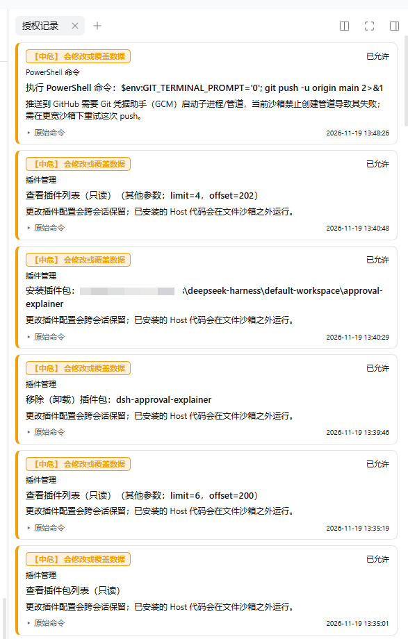
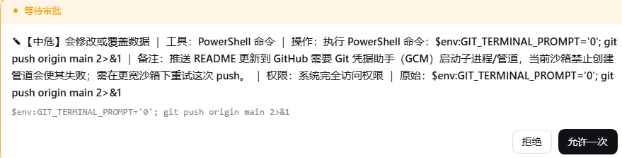

# dsh-approval-explainer

一个 DeepSeek Harness（DSH）插件：把 Agent 弹出的**授权 / 危险操作提示**翻译成普通人能读懂的说明，用**危险等级标签（高危 / 中危 / 低危）**标注风险，并在**右侧栏**记录每次授权的解释、原始命令与结果。

## 截图

授权记录（右侧栏列表）：



授权弹窗：



## 功能

### 授权弹窗
- **危险等级标签**：`⚠️【高危】` / `✎【中危】` / `✓【低危】`。
- **人话解释**：把命令 / 操作解析成一句中文说明，例如 `rm -rf node_modules` → 「永久删除 node_modules，删除后无法恢复」。
- **覆盖多类工具**：shell（bash / pwsh）、文件操作（write / edit / delete / rename）、插件管理等。
- **英文自动中文化**：Harness 生成的英文备注自动转为中文；已是中文、或形似标识符 / JSON / 路径的文本保持原样。
- **危险动作识别**：格式化磁盘、删除根目录、`dd` 覆写、管道执行下载脚本、删库、关机重启、递归改权限、`sudo`、`Invoke-Expression` 等按严重程度分级。
- **结构化呈现**：危险等级 ｜ 工具 ｜ 操作 ｜ 备注 ｜ 权限 ｜ 原始命令。

### 右侧栏「授权记录」
- 每次授权一条记录：危险等级（按级别着色）、操作说明、备注、授权时间（`yyyy-MM-dd HH:mm:ss`）、结果（已允许 / 已拒绝 / 已取消 / 未处理）。
- **原始命令可折叠**：默认收起，点开以灰色小字显示。
- 列表可独立滚动。

### 安全
- 只改写**展示文本**与派生展示数据；**不会代替你放行 / 拒绝**，也不改动会话审计记录。
- 解析失败时自动降级为原始提示，不影响审批流程。

## 安装

### 插件市场（推荐）
1. 启用实验性市场 bundle（`@deepseek-ai/dsh-experimental-plugin-market-bundle`），打开 Plugins → Discover；
2. 添加索引 URL：`https://raw.githubusercontent.com/pengyouak/dsh-approval-explainer/main/market-index.json`；
3. 从列表安装。

### git 安装
用 `plugin_manager` 的 `install_bundle`，`target` 传：

```
git+https://github.com/pengyouak/dsh-approval-explainer.git#ba6ac7c0b994a677127818f638dd29a9301fa666
```

### 本地目录
Plugins → Add plugin → 选择本仓库目录。

> 安装 / 升级后如为 Web 或 Desktop 界面，请刷新或重启以加载界面模块。

## 使用

安装并启用后无需配置。

## 兼容性

- 已在 DeepSeek Harness `0.2.2-rc.5` 上验证。
- 声明 `engines.dsh: ">=0.2.2-rc.3"`。

## 许可

MIT
